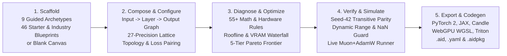
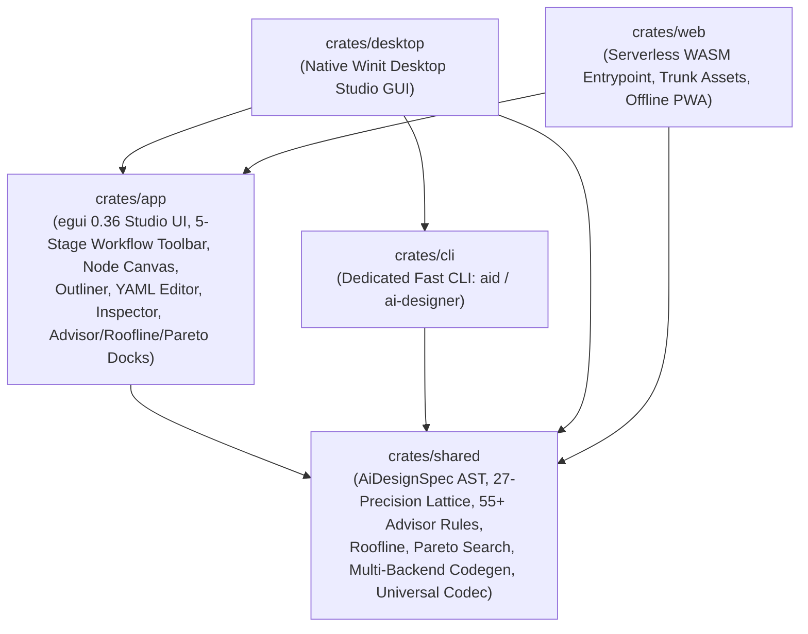

# `ai_designer` — AI Designer Studio & Training Suite

[](LICENSE)
[](https://www.rust-lang.org)
[](https://github.com/emilk/egui)
[](../../README.md)

**AI Designer Studio & Training Suite** (`tools/ai_designer/`) is the interactive visual architecture workbench and headless CLI compiler for the [`AI-Examples`](../../README.md) repository. Built in pure Rust with [`egui 0.36`](https://github.com/emilk/egui) / [`eframe 0.36`](https://docs.rs/eframe), it runs natively on **Desktop (Windows, macOS, Linux via Winit)**, in the **Browser (Serverless WebAssembly / PWA via Trunk)**, and as a **Headless CLI** for batch compilation, linting, Pareto optimization, and multi-format packaging.

---

## 🧭 1. End-to-End 5-Stage Usage Workflow

Both the interactive Studio GUI and the headless CLI follow a clear, progressive **5-stage design-to-deployment workflow** directly visible in the Studio's top workflow strip:



### Stage ① — Scaffold (`① ✨ New / Wizard` or Left Palette)
Choose how to initialize your model specification (`AiDesignSpec`):
- **Guided Archetypes (9 Presets):** Select a domain archetype (*Language Transformer*, *Vision / Spatiotemporal*, *Physics / SciML Operator*, *Robotics Diffusion Policy*, *Time-Series Forecaster*, *Tabular Monotonic Network*, *Reversible / Looped Deliberation*, *Sparse Mixture-of-Experts*), customize `d_model`, `depth`, and execution precision, and scaffold a complete computation graph.
- **Starter & Industry Blueprints (46 Pre-Engineered YAML Specs):** Load any of the 46 production blueprints in [`templates/`](templates/) — covering frontier industry architectures (DeepSeek-V3/R1, Flux.1/SD3 MMDiT, Llama-3.3/Qwen-2.5, Gemma-2/3, AlphaFold 3 Pairformer, V-JEPA/I-JEPA, Omnimodal Gemini Live/Moshi, OpenVLA/Pi0, ColPali, AlphaGenome/Enformer, GraphCast, 3D Gaussian Splatting), specialized ML paradigms (Recurrent-Depth TTT/Titans, DreamerV3 RSSM, Decision Transformer + DPO, RWKV-7 + Byte Latent Transformer, MatterGen Crystal Diffusion, Instant-NGP/SIREN NeRF, Liquid CfC, Neuromorphic Spiking LIF SNNs, Echo State & NG-RC Reservoirs, White-Box CRATE/DEQ/OptNet, Hyperbolic Poincaré Sheaf GFlowNets, Cryptographic zkML/CKKS, Quantum PQC-VQE, Photonic MZI & Memristive Crossbars), and all 18 [`AI-Examples`](../../README.md) categories — with one click.
- **Blank Canvas:** Start from clean input (`x`) and output (`y`) ports, or click **`⚡ Auto-Architect Synthesis`** to automatically synthesize a backbone tailored to your declared I/O tensor spaces.

### Stage ② — Compose & Configure (`2. Compose: Graph | Outliner | YAML (.yaml)`)
Edit your architecture across three synchronized views that update in real time:
- **Interactive Dataflow Graph (`Graph`):** Visual dataflow canvas rendering **Input Stream Cards**, **Computation Layer Cards**, and **Output Stream & Loss Cards** connected by cubic Bézier wires with midpoint symbolic shape chips (`[B, T, D]`), precision badges, and a top-left **Canvas HUD** (Zoom `-`, `100%`, `+`, `Auto-Layout`, `In -> Layers -> Out` counter, plus inline Move Up, Move Down, Duplicate, and Delete layer actions).
- **Hierarchy Outliner (`Outliner`):** Structured tree view of Input Streams, Macro Wiring Topology, Computation Layers (with inline reorder, duplicate, and delete buttons), Output Streams, and Training Regime.
- **Live Specification Source (`YAML (.yaml)`):** Direct `.yaml` specification editor with syntax validation and instant AST synchronization.
- **Left Sidebar (`Operator & Topic Catalog`):**
  - **Multi-Axis Layer Filters:** Filter 55 operators by text search, **Functional Category** (*Attention & Memory*, *State Space & Recurrent*, *Feedforward & Splines*, *Spectral & Physics*, *Norms & Activations*, *Routing & MoE*), and **Computational Paradigm / Complexity** (*Linear O(T) Sequence*, *KV-Compressed Attention*, *Quadratic / Global Mixing*, *Physics & Geometric*, *Sparse / Conditional*, *Dense Projection*, *Shape-Preserving*, *Optimization-as-Architecture*).
  - **Clickable Curriculum Links:** Every operator row, category header, and topic chip in the 18-category `AI-Examples` catalog links directly to its reference documentation.
- **Right Sidebar (`Layer & Blueprint Inspector`):**
  - **When a Layer is Selected:** Shows a clickable `AI-Examples` curriculum topic link, layer order controls (`Move Up`, `Move Down`, `Duplicate`, `Delete`), the **27-Format Numeric & Precision Lattice** selector, full operator-specific hyperparameters, and a bottom **"Node Overview & Architecture Guide"** card explaining *what the layer does*, *what it is typically used for*, *what usually follows it*, and one-click buttons to append recommended successor layers.
  - **When No Layer is Selected (or when an Input/Output Card is Clicked):** Configures model metadata, **Target Hardware Profile** (with `Auto-Detect Host`), **Muon 2D + AdamW 1D Parameter Partitioning**, **Gradient Hygiene** (`AutoClip`, `Grokfast`, `Activation Checkpointing`), **Macro Wiring Topology**, **Input Port Normalization & Coordinate Encoding**, and **Output Loss & Structural Constraints**.

### Stage ③ — Diagnose & Optimize (Bottom Dock: `⚡ Advisor`, `📊 Roofline`, `📈 Pareto`)
Every edit automatically re-evaluates four analytical engines:
1. **`⚡ Advisor` (55+ Domain & Hardware Rules):** Flags mathematical and systems failure modes (e.g., *MLA + coupled RoPE preventing KV absorption*, *unanchored recurrent depth loops washing out inputs*, *Euler integration on Hamiltonian systems*, *unnormalized Muon 1D vectors*) and provides one-click **`⚡ Quick Fix`** AST mutations.
2. **`📊 Hardware Roofline & VRAM`:** Computes operational intensity ($\text{FLOPs/Byte}$), classifies the model as **Compute Bound** vs. **Memory Bandwidth Bound** against the target hardware's ridge point, calculates the critical sequence horizon $L^*$ before OOM, and breaks down VRAM across Weights, Optimizer States, and Activations.
3. **`📈 Pareto Frontier (5)`:** Synthesizes 5 hardware-aware scaling variants (*1. Edge-Minimal*, *2. Latency-Optimal*, *3. Workstation-Balanced*, *4. High-Capacity*, *5. Frontier-Extreme*) comparing parameter count, FLOPs/token, step latency, and VRAM headroom with one-click **`✨ Apply Variant`**.

### Stage ④ — Verify, Mediate & Train (`④ ▶ Verify & Train`)
Open the **`▶ Training & Parity Runner`** dock in the Studio UI or invoke `aid train` from the CLI:
- **`🔬 Test Parity & Condition`:** Runs a deterministic Seed-42 forward pass across the computation graph, reporting activation dynamic range $[\min, \max]$, condition stability, and verifying zero `NaN`/`Inf` traps.
- **`1. 📈 Convergence & Telemetry`:** Dual custom Painter loss and gradient curves with live telemetry chips: loss (instant, smoothed, best), token throughput ($\text{tok/s}$), sample rate, VRAM utilization vs peak, Muon Newton-Schulz matrix polar orthogonality error ($\sim 10^{-6}$), AutoClip threshold, and multi-stage curriculum progress.
- **`2. 🎛️ Dynamic Optimizations & Auto-Meta-Tuning`:**
  - **Automated Online Meta-Optimizer:** Meta-parameters are continuously adapted throughout training via closed-loop feedback controllers across 4 selectable policies:
    - *Adaptive Convergence Guard:* Adapts LR scale based on loss velocity ($\Delta L / \text{step}$), automatically engaging Grokfast low-pass filtering when gradient SNR drops below 0.85, and auto-tuning AutoClip percentiles to prevent saturation.
    - *Hypergradient Descent (HD):* Evaluates online meta-gradients $(\nabla f_t)^T(\nabla f_{t-1})$ to dynamically scale the optimizer step size.
    - *Throughput Maximizer:* Dynamically minimizes Muon Newton-Schulz iterations when matrix polar orthogonality residual is well within tolerance ($<10^{-6}$), optimizing tokens/sec and VRAM.
    - *Loss Plateau Breaker:* Detects loss stagnation over consecutive steps and triggers controlled warm-restart perturbations to escape saddle points.
    - *Progressive QAT Annealing:* Dynamically anneals quantization target bitwidths ($16.0 \to \text{target}$) over the initial 65% of steps to prevent early divergent gradients.
  - **Real-Time In-Flight Hyperparameter Overrides:** Sliders for live learning rate scaling ($0.01\times - 5.0\times$), AutoClip percentile, Grokfast parameters, Muon NS polar steps ($1 - 10$), target QAT bitwidth ($1.58 - 16.0$ bits), activation checkpointing, and dynamic optimizer family switching (Muon+AdamW, AdamW, Lion, Sophia-G, Adan, L-BFGS, Schedule-Free, Paged 8-bit, SGD).
- **`3. 🚀 Environment Setup`:** Turnkey training workspace generator creating automated POSIX and PowerShell setup scripts (`setup_env.sh`, `setup_env.ps1`), launch runners (`run_training.sh`, `run_training.ps1`), Conda (`environment.yml`), `uv` (`pyproject.toml`), PyTorch model harnesses (`model.py`, `train.py`, `losses.py`, `data.py`), and runtime configs (`training_config.json`).
- **`4. 💻 Console Output`:** Colorized monospace terminal stdout/stderr stream with log filtering, one-click clipboard copy, and buffer clearing.

### Stage ⑤ — Export & Codegen (`5. Generate Target Code`, `.aid`, `.yaml`, `.aidpkg`)
- **`Generate Target Code`:** Opens the **Multi-Backend Target Code Generator** modal emitting complete source files for:
  - **PyTorch 2.x** (`pytorch/model.py`, `pytorch/train.py` with `torch.compile` and Muon/AdamW partitioning)
  - **JAX / Equinox** (`jax/model.py`, `jax/train.py` with `eqx.Module` and `jax.jit`)
  - **Rust Candle** (`candle/Cargo.toml`, `candle/src/model.rs`)
  - **WebGPU Compute Shaders** (`kernels/shaders.wgsl`, `kernels/cpu_simd.rs`)
  - **OpenAI Triton** (`kernels/triton_ops.py`)
  - **Cross-Backend Parity Harness** (`verify_and_bench.py`)
  - Includes one-click **`Copy File`**, **`Download File`**, and **`Save Bundle to Disk`** (`exported_models/<model_id>/`).
- **Native `.aid`, `.yaml` & `.aidpkg` Exports:**
  - **`.aid`:** Native binary byte container (`AID\x01` magic header + format descriptor + CRC32 integrity checksum + BSON payload).
  - **`.yaml`:** Human-readable YAML blueprint specification.
  - **`.aidpkg`:** 64-byte page-aligned single-file package bundling the blueprint specification, manifest, and optional `.safetensors` weights.

---

## 🏛️ 2. Workspace Architecture

`tools/ai_designer` is organized into four single-responsibility crates:



| Crate | Path | Responsibility |
| :--- | :--- | :--- |
| **`shared`** | [`crates/shared`](crates/shared) | Strongly-typed `AiDesignSpec` AST (`spec/`), shape inference, hardware probe, analytical Roofline & Muon/AdamW partitioner (`analysis/`), 55+ rule diagnostic engine, auto-architect & Pareto search (`advisor/`), 5-track code generator (`codegen/`), importers (`importer/`), and universal format codecs (`format/`). |
| **`app`** | [`crates/app`](crates/app) | Cross-platform `egui` / `eframe` UI view-controller (`StudioState`, `DesignWizardModal`, `PaletteView`, `InspectorView`, `CanvasNodeView`, `CanvasTreeView`, `CanvasYamlView`, `AdvisorDockView`, `RooflineDockView`, `StudioRunnerView`, `CodeViewerView`, and multi-tier `localStorage`/`IndexedDB` persistence). |
| **`cli`** | [`crates/cli`](crates/cli) | Dedicated headless CLI compiler (`aid` and `ai-designer` binaries) for fast, scriptable batch compilation, linting, packaging, and training planning with zero GUI/graphics overhead. |
| **`desktop`** | [`crates/desktop`](crates/desktop) | Native desktop runner (`cargo run -p desktop`) with `mimalloc` global allocator. |
| **`web`** | [`crates/web`](crates/web) | WebAssembly client entrypoint (`wasm-bindgen`), PWA manifest, offline Service Worker, and Trunk build configuration. |

---

## 🚀 3. Quickstart: GUI & Dedicated CLI

All commands below are run from `tools/ai_designer/`.

### A. Dedicated Standalone CLI (`aid` / `ai-designer`)
```bash
# Run directly via Cargo:
cargo run -p ai-designer-cli --bin aid -- --help

# Or install locally to your PATH for instant invocation:
cargo install --path crates/cli
aid --help
```

### B. Launch Native Desktop Studio GUI
```bash
cargo run -p desktop
# Or explicitly:
cargo run -p desktop -- --gui
```

### C. Launch WebAssembly Studio Locally (Trunk)
```bash
trunk serve
```
Open [http://localhost:8080](http://localhost:8080) in your browser.

### D. CLI Subcommand Reference (`aid <subcommand>`)

The standalone `aid` binary executes instantly with zero graphics initialization overhead:

| Subcommand | Example Invocation | Description |
| :--- | :--- | :--- |
| **`help`** | `cargo run -p ai-designer-cli --bin aid -- --help` | Displays full CLI usage manual and format matrix. |
| **`new`** | `aid new my_net --preset transformer --dim 512 --depth 6 --precision bf16 -o my_net.aid` | Scaffolds a new architecture from any preset (`blank`, `transformer`, `vision`, `physics`, `robotics`, `timeseries`, `tabular`, `residual`, `moe`, `supersmooth`, `quantization`, `tts`, `rawbyte`, `gatedmixer`, `ssl`, `gbdt`) into `.aid` or `.yaml`. |
| **`template`** | `aid template list`<br/>`aid template 21 -o deepseek.yaml` | Lists all 59 starter & industry blueprints or exports a template by index/name. |
| **`plan`** | `aid plan my_net.yaml`<br/>`aid plan my_net.yaml --preset frontier_llm --gpus 16 -o planned.yaml` | Analyzes training curricula, Chinchilla token budget, parameter partitioning (Muon vs AdamW), 4D parallelism, and QAT bitwidth schedule. Use `aid plan list` to list all 12 presets. |
| **`train setup`** | `aid train setup my_net.yaml -o workspace/` | Generates a turnkey, production-ready training environment workspace on disk with virtualenvs (`uv`/Conda), automated launch scripts (`.sh`/`.ps1`), PyTorch model, train loop, losses, data pipelines, and config. |
| **`train run`** | `aid train run my_net.yaml --steps 100 --policy guard`<br/>`aid train run my_net.yaml --policy hypergrad --no-auto-tune` | Executes a mediated training process with high-frequency telemetry, online meta-parameter auto-tuning (LR, AutoClip, Grokfast SNR filter, Muon NS steps, progressive QAT), and transitive parity validation. |
| **`train status`** | `aid train status` | Probes host acceleration capabilities, detected PyTorch runtime, memory rooflines, and supported optimizers. |
| **`lint`** | `aid lint dit.yaml --fix` | Evaluates all 55+ mathematical and hardware advisor rules with optional `--fix` AST auto-repair. |
| **`verify`** | `aid verify dit.yaml` | Runs deterministic Seed-42 forward pass, shape inference, and dynamic-range / `NaN` verification. |
| **`pareto`** | `aid pareto dit.yaml` | Synthesizes and scores 5 hardware-aware Pareto candidates across FLOPs, latency, and VRAM. |
| **`export`** | `aid export dit.yaml -o build_out` | Exports a full multi-backend project directory (`pytorch/`, `jax/`, `candle/`, `kernels/`, `verify_and_bench.py`) or converts between `.aid`, `.yaml`, `.json`, `.toml`, `.bson`, `.ron`, `.aidpkg`, and `.tar.gz`. |
| **`import`** | `aid import config.json -o imported.aid` | Ingests `.safetensors` headers, HuggingFace `config.json`, Python `nn.Module` ASTs, or existing blueprints. |
| **`package`** | `aid package dit.yaml --weights model.safetensors -o model.aidpkg` | Bundles specification and weights into a 64-byte page-aligned `.aidpkg`, `.pkg`, or `.tar.gz` archive. |
| **`unpack`** | `aid unpack model.aidpkg -o extracted/` | Extracts blueprints, manifest, and weights from `.aidpkg`, `.pkg`, or `.tar.gz`. |
| **`hardware`** | `aid hardware` | Probes host CPU cores, OS, architecture, and live GPU specs via `nvidia-smi`. |
| **`catalog`** | `aid catalog` | Lists all 18 `AI-Examples` curriculum categories and their representative topics. |
| **`audit`** | `aid audit ../../pytorch2` | Audits repository PyTorch 2 modules and summarizes operator AST coverage. |

---

## 📋 4. Pre-Engineered Starter & Industry Blueprints (`templates/`)

The Studio bundles 59 blueprints in [`templates/`](templates/) (embedded at compile time for instant offline access in both Desktop and WASM), spanning all 18 curriculum categories, frontier industry models, scientific foundation models, and specialized/rare ML paradigms:

| # | Blueprint File | Architecture & Domain Focus |
| :- | :--- | :--- |
| `01` | [`01_spatiotemporal_dit_flow.yaml`](templates/01_spatiotemporal_dit_flow.yaml) | Vision & 3D Geometry: Patchify + `WTConv` + 2D/3D-RoPE + `SlotAttention` + `OT-CFM` |
| `02` | [`02_bimanual_diffusion_act_policy.yaml`](templates/02_bimanual_diffusion_act_policy.yaml) | Robotics & Control: Action Chunking + `SO(3)` 6D Rotation + `CBF-QP` Safety Filter |
| `03` | [`03_streaming_codec_mamba.yaml`](templates/03_streaming_codec_mamba.yaml) | Audio & DSP: Periodic `Snake` Activation + Causal `Mamba-2 SSD` + Unrolled `LISTA` |
| `04` | [`04_symplectic_fourier_neural_operator.yaml`](templates/04_symplectic_fourier_neural_operator.yaml) | SciML & Physics: Spectral `FNO` + Reversible Stream + Curl-Free / Symplectic Conservation |
| `05` | [`05_equivariant_biomolecular_flow.yaml`](templates/05_equivariant_biomolecular_flow.yaml) | Structural Biology: `Evoformer` Triangle + `IPA` + $E(3)$-Equivariant `EGNN` + `FAPE` |
| `06` | [`06_patch_xlstm_probabilistic_forecaster.yaml`](templates/06_patch_xlstm_probabilistic_forecaster.yaml) | Time-Series & Finance: `RevIN` + `xLSTM` (`mLSTM`) + Quantile `CRPS` / `GPD` Tail Risk |
| `07` | [`07_monotonic_ple_tabpfn.yaml`](templates/07_monotonic_ple_tabpfn.yaml) | Tabular & Clinical: Piecewise Linear Embeddings (`PLE`) + `HardConcreteL0` + Monotonic Constraints |
| `08` | [`08_hybrid_jamba_mla_verifier.yaml`](templates/08_hybrid_jamba_mla_verifier.yaml) | Language & Reasoning: Hybrid `Mamba-2 SSD` + `MLA` (Decoupled RoPE) + `DeepSeekMoE` + `GRPO` |
| `09` | [`09_autograd_custom_kernel_backward.yaml`](templates/09_autograd_custom_kernel_backward.yaml) | Foundations: Custom Autograd JVP/VJP & Fused Kernel Verification |
| `10` | [`10_optimal_transport_sinkhorn_matcher.yaml`](templates/10_optimal_transport_sinkhorn_matcher.yaml) | Paradigms & Combinatorics: Differentiable Permutahedron & Optimal Transport |
| `11` | [`11_muon_wsd_accelerated_transformer.yaml`](templates/11_muon_wsd_accelerated_transformer.yaml) | Training Optimization: Newton-Schulz `Muon` + `AdamW` Partition + `WSD` Schedule |
| `12` | [`12_safe_cbf_qp_diffusion_policy.yaml`](templates/12_safe_cbf_qp_diffusion_policy.yaml) | Safe Embodied AI: Control Barrier Function `CBF-QP` + Trajectory Optimization |
| `13` | [`13_structural_causal_neural_scm.yaml`](templates/13_structural_causal_neural_scm.yaml) | Causal AI: Identifiable Representation & Structural Causal Model |
| `14` | [`14_monosemantic_sparse_autoencoder_sae.yaml`](templates/14_monosemantic_sparse_autoencoder_sae.yaml) | Mechanistic Interpretability: Sparse Autoencoder (`SAE`) + $L_0$ / `Entmax-1.5` |
| `15` | [`15_differentially_private_dp_sgd.yaml`](templates/15_differentially_private_dp_sgd.yaml) | Privacy & Cryptographic AI: Per-Sample Gradient Clipping & Formal Bounds |
| `16` | [`16_torch_compile_inductor_fastpath.yaml`](templates/16_torch_compile_inductor_fastpath.yaml) | Compilation & Performance: Zero-Graph-Break Static Shape Fastpath |
| `17` | [`17_bitnet_ternary_1_58_quant.yaml`](templates/17_bitnet_ternary_1_58_quant.yaml) | Precision & Extreme Quantisation: Native Ternary `BitNet b1.58` |
| `18` | [`18_awq_activation_aware_quantizer.yaml`](templates/18_awq_activation_aware_quantizer.yaml) | Activation-Aware Quantisation: Salient Channel Protection (`AWQ`) & `NF4`/`FP8` |
| `19` | [`19_speculative_medusa_draft_decoder.yaml`](templates/19_speculative_medusa_draft_decoder.yaml) | Compression & Speculative Decoding: Multi-Head Medusa Draft Decoder |
| `20` | [`20_fsdp2_ring_attention_transformer.yaml`](templates/20_fsdp2_ring_attention_transformer.yaml) | Distributed & Cluster Scale: FSDP2 & Ring Attention Multi-Node Transformer |
| `21` | [`21_deepseek_v3_r1_mla_moe_mtp.yaml`](templates/21_deepseek_v3_r1_mla_moe_mtp.yaml) | **Industry LLM (DeepSeek-V3 / R1):** Decoupled-RoPE `MLA` + Aux-Loss-Free 256-Expert `DeepSeekMoE` + `MultiTokenPrediction` + `FP8` + `GRPO` |
| `22` | [`22_flux_mmdit_rectified_flow_generator.yaml`](templates/22_flux_mmdit_rectified_flow_generator.yaml) | **Industry Image Generator (Flux.1 / SD3):** Dual-Stream `AdaLNZeroDiT` MMDiT + Single-Stream DiT + `QKNorm` + 2D-RoPE + `OT-CFM` Rectified Flow |
| `23` | [`23_llama3_qwen25_dense_gqa_llm.yaml`](templates/23_llama3_qwen25_dense_gqa_llm.yaml) | **Industry Dense LLM (Llama-3.3 / Qwen-2.5):** 8:1 `GQA` + `500K-Theta RoPE` + Untied `SwiGLU` + `128K` Vocab |
| `24` | [`24_gemma2_local_global_softcap_llm.yaml`](templates/24_gemma2_local_global_softcap_llm.yaml) | **Industry Hybrid-Window LLM (Gemma-2 / 3):** Interleaved Sliding-Window & Global `GQA` + Sandwich-`RMSNorm` + `GeGLU` + `LogitSoftCap` |
| `25` | [`25_recurrent_depth_ttt_titans_reasoner.yaml`](templates/25_recurrent_depth_ttt_titans_reasoner.yaml) | **Latent Test-Time Compute:** `RecurrentDepth` (`PonderNet KL` Halting) + `TitansMemory` + `TTT` + `DiffAttn` + `ModernHopfield` |
| `26` | [`26_gaussian_splatting_plucker_3d_reconstructor.yaml`](templates/26_gaussian_splatting_plucker_3d_reconstructor.yaml) | **3D Vision (LGM / GS-LRM):** 6D Plücker Ray Embeddings + `ConvNeXtV2` + Cross-View `GQA` + `GaussianSplatting3D` (`SH` degree 3) |
| `27` | [`27_liquid_cfc_drone_flight_controller.yaml`](templates/27_liquid_cfc_drone_flight_controller.yaml) | **Continuous-Time Robotics (Liquid CfC):** Closed-Form Continuous-Time `LiquidNeuralCfC` + `SO(3)` Attitude + `CBF-QP` Barrier |
| `28` | [`28_spiking_lif_neuromorphic_event_processor.yaml`](templates/28_spiking_lif_neuromorphic_event_processor.yaml) | **Neuromorphic Edge AI:** Asynchronous Event-Camera DVS + `SpikingLIF` Surrogate-Gradient SNN on Cortex-M55 |
| `29` | [`29_reservoir_esn_ngrc_chaotic_attractor.yaml`](templates/29_reservoir_esn_ngrc_chaotic_attractor.yaml) | **Reservoir Computing:** `EchoStateNetwork` + Next-Gen Delay-Tap Polynomial Reservoir (`NG-RC`) in IEEE `FP64` |
| `30` | [`30_whitebox_crate_deq_optnet_solver.yaml`](templates/30_whitebox_crate_deq_optnet_solver.yaml) | **Optimization-as-Architecture:** White-Box `CRATE` + Unrolled `ADMMNet` + Implicit `DEQ` + `OptNetKKT` Convex QP Layer |
| `31` | [`31_hyperbolic_poincare_sheaf_gflownet.yaml`](templates/31_hyperbolic_poincare_sheaf_gflownet.yaml) | **Non-Euclidean & Topological ML:** `HyperbolicPoincareLayer` + `CellularSheafConv` + `CliffordGeometricProduct` + `GFlowNet` |
| `32` | [`32_zkml_homomorphic_verifiable_classifier.yaml`](templates/32_zkml_homomorphic_verifiable_classifier.yaml) | **Cryptographic & Verifiable AI (zkML / FHE):** Exact Polynomial `KAN` + `INT8` Lookup + `CROWN/IBP` Certified Robustness |
| `33` | [`33_alphafold3_pairformer_atomic_diffusion.yaml`](templates/33_alphafold3_pairformer_atomic_diffusion.yaml) | **Biomolecular Foundation (AlphaFold 3):** 4-Block `EvoformerTriangle` + 48-Block `PairformerBlock` + `AdaLNZeroDiT` All-Atom Diffusion |
| `34` | [`34_vjepa_ijepa_latent_video_world_model.yaml`](templates/34_vjepa_ijepa_latent_video_world_model.yaml) | **Self-Supervised World Model (V-JEPA / I-JEPA / JEV):** 3D Tubelet Context ViT + `JEPAPredictor` (`EMA` Target Alignment) + `VICReg` |
| `35` | [`35_omnimodal_native_speech_vision_llm.yaml`](templates/35_omnimodal_native_speech_vision_llm.yaml) | **Omnimodal Duplex AI (Gemini Live / Moshi):** Interleaved RVQ Audio + Vision + Text `GQA` + 8-Codebook `MultiTokenPrediction` |
| `36` | [`36_openvla_pi0_vision_language_action_policy.yaml`](templates/36_openvla_pi0_vision_language_action_policy.yaml) | **Embodied VLA Foundation (OpenVLA / $\pi_0$):** SigLIP Patches + VLM `GQA` + `AdaLNZeroDiT` 50-Hz Flow-Matching Action Expert |
| `37` | [`37_colpali_late_interaction_document_retriever.yaml`](templates/37_colpali_late_interaction_document_retriever.yaml) | **Visual Document Retrieval (ColPali / ColQwen2):** High-Res Document Patch VLM + `ColPaliMaxSim` 128-D Multi-Vector MaxSim + `InfoNCE` |
| `38` | [`38_dreamerv3_rssm_imagination_world_model.yaml`](templates/38_dreamerv3_rssm_imagination_world_model.yaml) | **Model-Based RL World Model (DreamerV3 / MuZero):** `Symlog` Input + `WorldModelRSSM` ($32 \times 32$ Unimix Categorical) + Two-Hot Symexp Head |
| `39` | [`39_decision_transformer_dpo_preference_aligner.yaml`](templates/39_decision_transformer_dpo_preference_aligner.yaml) | **Offline RL & Preference Alignment:** Return-to-Go Causal `GQA` + `LogitSoftCap` + `DPOContrastiveLogRatio` Alignment |
| `40` | [`40_alphagenome_enformer_regulatory_dna_model.yaml`](templates/40_alphagenome_enformer_regulatory_dna_model.yaml) | **Regulatory Genomics (AlphaGenome / Enformer):** 1-Mb DNA `WTConv` Tower + Long-Range `GQA` + 5,313 Epigenomic Assay Readout |
| `41` | [`41_mattergen_equivariant_crystal_diffusion.yaml`](templates/41_mattergen_equivariant_crystal_diffusion.yaml) | **Materials Discovery (MatterGen / CDVAE):** `PeriodicCrystalLattice` ($SO(3)\times\mathbb{Z}^3$) + `EGNN` + `CliffordGeometricProduct` |
| `42` | [`42_instant_ngp_siren_volumetric_nerf.yaml`](templates/42_instant_ngp_siren_volumetric_nerf.yaml) | **Volumetric NeRF (Instant-NGP / SIREN):** 5D Ray `MultiresHashGrid` (16 Levels) + High-Freq Periodic `Snake` ($\omega_0=30$) + Density/RGB |
| `43` | [`43_graphcast_spherical_icosahedral_weather.yaml`](templates/43_graphcast_spherical_icosahedral_weather.yaml) | **Global Weather Forecasting (GraphCast / NeuralGCM):** 37-Level ERA5 Grid2Mesh + `SphericalMeshGNN` + Spectral `FNO` + Curl-Free Head |
| `44` | [`44_rwkv7_blt_byte_latent_transformer.yaml`](templates/44_rwkv7_blt_byte_latent_transformer.yaml) | **Tokenizer-Free State-Tracking LLM (BLT + RWKV-7):** Raw UTF-8 `EntropyBytePatcher` + `RWKV7DeltaRule` Generalized Delta-Rule RNN |
| `45` | [`45_quantum_variational_pqc_hybrid_eigensolver.yaml`](templates/45_quantum_variational_pqc_hybrid_eigensolver.yaml) | **Quantum Neural Network (PQC-VQE):** Data Re-Uploading Bloch Angles + 16-Qubit `QuantumVariationalCircuit` + Hamiltonian Readout |
| `46` | [`46_photonic_mzi_memristive_analog_accelerator.yaml`](templates/46_photonic_mzi_memristive_analog_accelerator.yaml) | **Photonic & Analog Crossbar AI:** Coherent 64-Mode `PhotonicMZIMesh` Clements Interferometer + Electro-Optic `Snake` + 8-Bit TIA Readout |
| `47` | [`47_simplicial_hodge_laplacian_topological_net.yaml`](templates/47_simplicial_hodge_laplacian_topological_net.yaml) | **Topological Deep Learning:** Simplicial & Cellular Hodge-Laplacian (0/1/2-simplices) + Helmholtz-Hodge Decomposition |
| `48` | [`48_continuous_normalizing_flow_ffjord_copula.yaml`](templates/48_continuous_normalizing_flow_ffjord_copula.yaml) | **Continuous Normalizing Flow (FFJORD):** Hutchinson trace log-det Jacobian estimation + Neural Vine Copula Splines |
| `49` | [`49_energy_based_langevin_predictive_coding.yaml`](templates/49_energy_based_langevin_predictive_coding.yaml) | **Energy-Based & Non-Backprop AI:** Predictive Coding Network (PCN) + Langevin MCMC Relaxation + Hopfield Basins |
| `50` | [`50_neurosymbolic_logic_tensor_dnc_memory.yaml`](templates/50_neurosymbolic_logic_tensor_dnc_memory.yaml) | **Neurosymbolic Reasoning & Memory:** DNC Matrix Memory + Łukasiewicz Logic Tensor Network (LTN) t-norm Constraints |
| `51` | [`51_qmix_multi_agent_cfr_game_coordinator.yaml`](templates/51_qmix_multi_agent_cfr_game_coordinator.yaml) | **Multi-Agent RL & Game Theory:** Monotonic QMIX Value Mixer + TarMAC + Counterfactual Regret (CFR) Equilibrium Solver |
| `52` | [`52_spintronic_skyrmion_organoid_active_inference.yaml`](templates/52_spintronic_skyrmion_organoid_active_inference.yaml) | **Spintronic & Wetware AI:** Magnetic Skyrmion Spin-Torque Reservoir + Biological Cortical Organoid Active Inference |
| `53` | [`53_attention_is_not_all_you_need_gmlp_hyena.yaml`](templates/53_attention_is_not_all_you_need_gmlp_hyena.yaml) | **Attention-Free Sequence Mixing:** gMLP Spatial Gating Unit (SGU) + Hyena Long Convolutions (Rank-Collapse Proof) |
| `54` | [`54_raw_bit_byte_megabyte_mambabyte_llm.yaml`](templates/54_raw_bit_byte_megabyte_mambabyte_llm.yaml) | **Raw Bit/Byte Foundation Model:** MegaByte / MambaByte / bGPT Multi-Scale Hierarchical Bit-Plane Autoregressive LLM |
| `55` | [`55_zero_shot_voice_cloning_codec_flow_tts.yaml`](templates/55_zero_shot_voice_cloning_codec_flow_tts.yaml) | **Zero-Shot Voice Cloning & TTS:** F5-TTS / VALL-E In-Context Acoustic Prompts + 8-Codebook RVQ + Flow Matching |
| `56` | [`56_tabular_gbdt_vime_self_supervised_booster.yaml`](templates/56_tabular_gbdt_vime_self_supervised_booster.yaml) | **Self-Supervised Tabular GBDT:** Oblivious Trees (CatBoost/NODE) + VIME Mask/Value Self-Supervision + KAN Calibration |
| `57` | [`57_self_supervised_dinov2_mae_vicreg_vision.yaml`](templates/57_self_supervised_dinov2_mae_vicreg_vision.yaml) | **Unified Self-Supervised Vision:** DINOv2 EMA Student-Teacher + Sinkhorn Prototypes + MAE/I-JEPA + VICReg Anti-Collapse |
| `58` | [`58_super_smooth_lipschitz_sobolev_icnn.yaml`](templates/58_super_smooth_lipschitz_sobolev_icnn.yaml) | **Super-Smooth & Certified Lipschitz AI:** Björck Orthonormalization + Cayley + C^∞ SoftplusBeta/GroupSort-2 + Sobolev H^2 |
| `59` | [`59_learnable_quantization_lsq_fracbits_qat.yaml`](templates/59_learnable_quantization_lsq_fracbits_qat.yaml) | **Learnable Quantization Level QAT:** LSQ+ Learnable Step-Size + PACT Clipping + FracBits Differentiable Mixed-Bitwidth + BOPs Penalty |

---

## ⌨️ 5. UI Design Standards & Keyboard Shortcuts

The Studio interface is designed around progressive disclosure, immediate visual feedback, and keyboard/mouse ergonomics:

| Input / Shortcut | Action in AI Designer Studio |
| :--- | :--- |
| **`Middle-Mouse Drag`** or **`Alt + Left-Drag`** | Pan smoothly across the Node Graph canvas |
| **`Scroll Wheel`** or **HUD `➖` / `100%` / `➕`** | Zoom in/out on the Node Graph canvas (`25%` to `250%`, with automatic Level-of-Detail shape chips) |
| **`Home`** or **`🎯 Reset & Auto-Layout`** | Reset camera pan/zoom and arrange all nodes into a clean left-to-right flow grid |
| **`Left-Click Node`** | Select node and open its hyperparameters & 27-precision selector in the Right Inspector |
| **`⬆` / `⬇` / `⧉` / `🗑`** (Canvas HUD, Outliner, or Inspector) | Reorder selected layer earlier/later, duplicate layer, or delete layer |
| **`Delete` / `Backspace`** | Delete the currently selected layer on the canvas (when no text input is focused) |
| **`Escape`** | Close any open modal window (`Wizard`, `Code Viewer`, `Help`, `Telemetry`, `Storage`) or deselect the active node |
| **`🎨 Theme` Button** (Top Navbar) | Cycle between **Charcoal Dark**, **Warm Light**, **High Contrast Dark**, and **High Contrast Light** (with automatic `44×44` accessible touch targets) |

---

## 🧪 6. Testing & Verification

Run the complete workspace test suite from `tools/ai_designer/`:

```bash
# Run all unit, integration, and 46-template roundtrip tests
cargo test --workspace

# Run clippy static analysis across all targets
cargo clippy --workspace --all-targets --all-features -- -D warnings
```

| Test Suite | Location | Coverage |
| :--- | :--- | :--- |
| **App & Studio Workflow Tests** | [`crates/app/tests/app_tests.rs`](crates/app/tests/app_tests.rs) | Studio initialization, 5-tier Pareto frontier caching, layer reordering/duplication/deletion, auto-layout, and multi-tier session persistence |
| **59-Template & `.aidpkg` Roundtrip** | [`crates/shared/tests/templates_test.rs`](crates/shared/tests/templates_test.rs) | Parses, re-serializes, and verifies `.yaml`, `.ron`, `.aidpkg`, shape inference, parameter partitioning, and Seed-42 numerical parity across all 59 starter, industry & specialized templates |
| **Spec, Rules & Codec Unit Tests** | [`crates/shared/src/`](crates/shared/src/) | 27-precision lattice, 55+ advisor rules, shape inference, seed-42 parity verifier, roofline analysis, and multi-backend codegen |
| **Desktop & Web Smoke Tests** | [`crates/desktop/tests/smoke_tests.rs`](crates/desktop/tests/smoke_tests.rs), [`crates/web/tests/smoke_tests.rs`](crates/web/tests/smoke_tests.rs) | Native viewport and WebRunner initialization checks |

---

## 📄 License

Dual-licensed under [MIT](LICENSE-MIT) or [Apache 2.0](LICENSE-APACHE) at your option.
